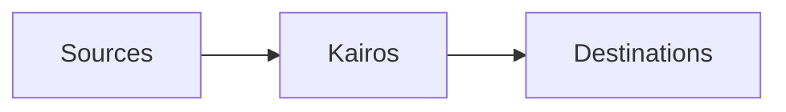

# Core Concepts

Kairos is a customer data platform (CDP). A CDP brings together data about customer activity and makes it available to other systems.

## Sources

A source is a system that provides data to Kairos. Jurassic Pets, an online shop selling pet dinosaurs, has a website and a mobile app. Each is a separate source.

## Events

An event is a record of something that happened at a particular time.

In Jurassic Pets, viewing a dinosaur, adding it to the cart, and completing an order are separate events. Each records the action, when it happened, and relevant details—for example, which dinosaur was added and how many.

Sources send these events to Kairos for processing and delivery to destinations.

## Inside Kairos

A CDP sits between the systems that produce customer data and those that use it. Its job is to make that data useful and send it where it belongs.

Processing can include checking incoming data, putting it into a consistent format, or adding context. The steps depend on the platform and how it is configured.

For Jurassic Pets, a purchase recorded by the store might be useful to both an analytics tool and an email service. Kairos occupies the middle of that flow: receiving the data, processing it, and passing it on.

## Destinations

A destination is a system that receives data from Kairos. Jurassic Pets might use an analytics tool to understand which dinosaurs sell best, or a data warehouse to combine purchases with other business data.
